# HuellitasVet 🐾

App móvil de una veterinaria con **dos perfiles en el mismo dispositivo**. El **Dueño** registra a sus mascotas, pide citas eligiendo servicio, fecha y hora, y revisa el historial clínico de cada una. El **Veterinario** ve la agenda, confirma citas, registra la atención (diagnóstico, tratamiento y peso), consulta a los pacientes y administra los servicios. Los dos perfiles comparten la misma base de datos Room: cuando el veterinario registra una atención, el dueño la ve al instante en el historial de su mascota.

## Estructura

```
com.junco.huellitasvet
├── MainActivity.kt
├── VetApp.kt                      crea la base, el repository y las preferencias
├── data
│   ├── local
│   │   ├── entity    Servicio · Usuario · Mascota · Cita
│   │   │             · Vacuna
│   │   ├── dao       ServicioDao · UsuarioDao · MascotaDao · CitaDao
│   │   │             · VacunaDao
│   │   ├── relation  MascotaConDueno · CitaConDetalle
│   │   ├── VetDatabase.kt
│   │   └── DatosIniciales.kt
│   ├── repository    VetRepository (interface) · VetRepositoryRoom
│   └── prefs         PreferenciasStore (DataStore)
├── model             Enums · ConteoServicio · Horarios (+ Formato)
│                     · PuntoPeso
├── viewmodel         Sesion · Inicio · Mascota · PedirCita · MisCitas
│                     Panel · Agenda · AtenderCita · Pacientes · Servicios
│                     · ReprogramarCita
└── ui
    ├── theme         Color · Type · Theme (VetTheme por perfil + degradado)
    ├── components    Contenedores (cabecera, tarjeta, datos destacados)
    │                 AppTopBar · VetButton · VetTextField · EstadoCitaChip
    │                 MascotaAvatar · CitaCard · SelectorFechaHora
    │                 HistorialItem · OpcionChip · FilaSwitch · graficos/
    │                 · CalendarioMes
    ├── navigation    Rutas · NavVet
    ├── dueno         Splash · Login · Registro · Inicio · Mascotas
    │                 FormularioMascota · FichaMascota · PedirCita
    │                 MisCitas · Perfil
    │                 · ReprogramarCita
    └── veterinario   Panel · Agenda · AtenderCita · Pacientes
                      Servicios · FormularioServicio · Ajustes
```

## Capturas

### Dueño

| Inicio de sesión | Inicio | Pedir cita |
| --- | --- | --- |
| 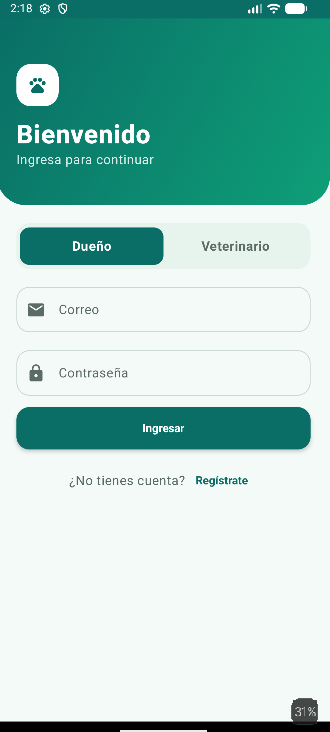 | 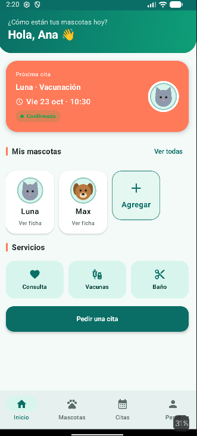 | 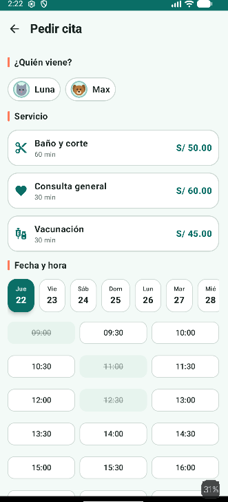 |

### Veterinario

| Panel | Agenda | Atender cita |
| --- | --- | --- |
| 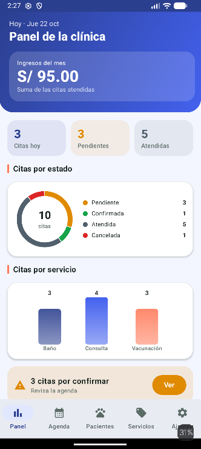 | 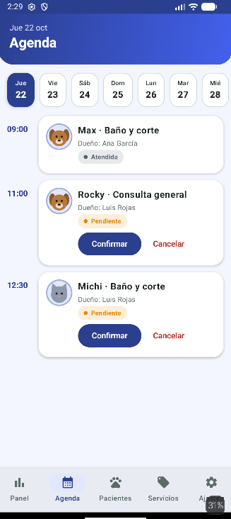 | 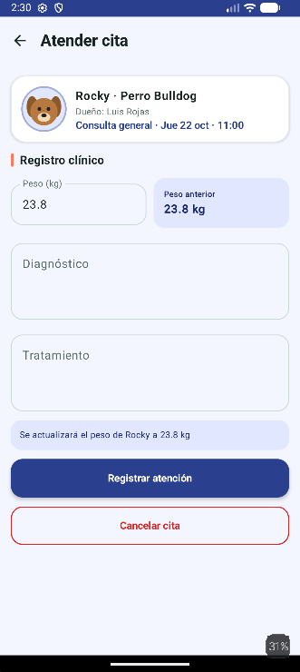 |

### Capturas de la Fase 2

| Gráfico de peso | Reprogramar cita | Búsqueda de pacientes |
| --- | --- | --- |
| 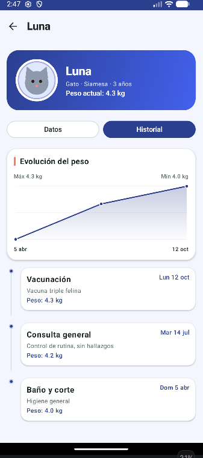 | 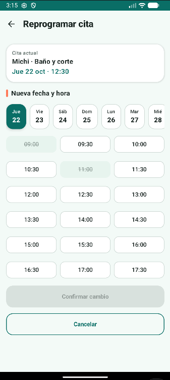 | 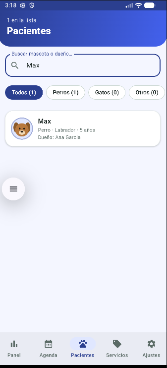 |

| Carnet de vacunas | Próximo control | Calendario mensual |
| --- | --- | --- |
| 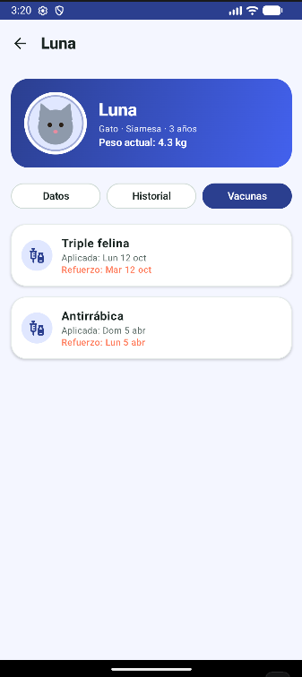 | 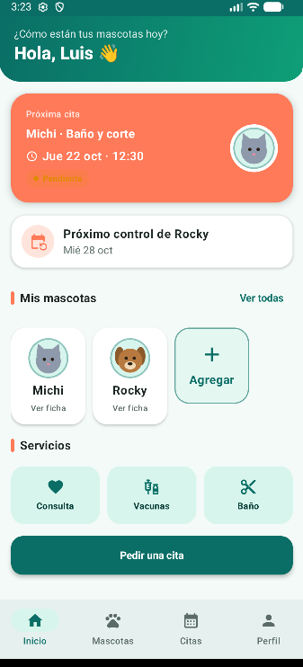 | 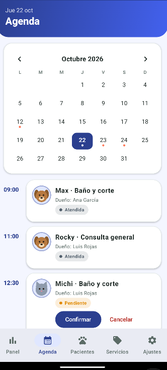 |

